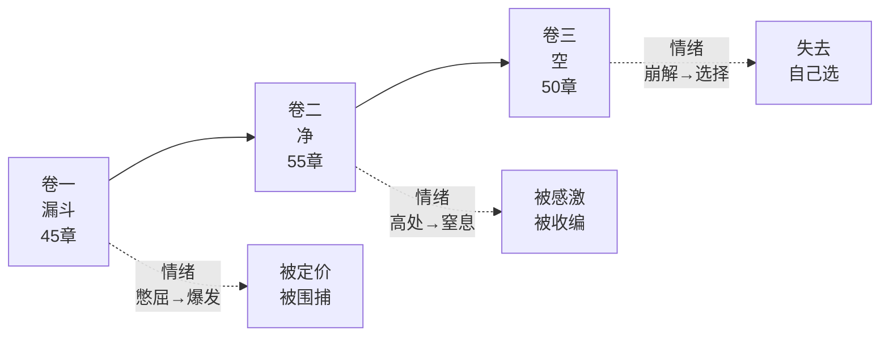

# 《浊世》全书大纲

> 配套文件：[末世修仙设定集.md](末世修仙设定集.md)
>
> 体量：三卷 150 章，约 45 万字（单章 2800–3200 字）
>
> 卷一《漏斗》45 章 · 卷二《净》55 章 · 卷三《空》50 章

---

## 零、总纲

### 0.1 一句话

一个靠替人咽下脏东西活着的拾荒者，被这个世界发现之后，必须在"成为工具"和"成为怪物"之间，替自己找第三条路。

### 0.2 三幕骨架

| 幕 | 卷 | 核心问题 | 答案 |
|---|---|---|---|
| 第一幕 | 卷一《漏斗》 | **别人怎么看他？** | 一件好用的工具 |
| 第二幕 | 卷二《净》 | **别人要他做什么？** | 救世主、干净的神、活着的药 |
| 第三幕 | 卷三《空》 | **他要做什么？** | 做那个"让洞里透光的人" |

**一句话弧光**：**从"卖命"到"认命"**。
他先是被当成漏斗，再被当成神，最后自己选了一个名字——而那个名字，他妈临死前叫过。

### 0.3 三条主线（必须同步推进）

| 线 | 内容 | 节奏 |
|---|---|---|
| **能力线** | 空窍·滤 → 逆 → 空；浊池 0 → 三成 → 五成 → 七成 → 满 | 每卷破一次线，每次破都付出具体代价 |
| **势力线** | 鬼市（底层）→ 定海司（国家）→ 十二宗（秩序）→ 残界教（信仰） | 逐层上升，每一层都给他新筹码，也都想把他据为己有 |
| **亲情线** | 老周（父）→ 阿枝（女）→ 陆晚（母） | 这三人是他"还是人"的三根钉子，一根一根被拔 |

**三条线在同一点交汇**：**浊池满了，他就不是他了。**
所以亲情线决定他"愿不愿意撑"，势力线决定他"能不能撑"，能力线决定他"还剩多少撑"。

### 0.4 大汐倒计时（全书的钟）

| 节点 | 时间 | 意义 |
|---|---|---|
| 起点 | 新历 73 年，第 6 次大汐结束 3 个月 | 世界刚被洗过一遍，地图作废，仇恨重算 |
| 卷一末 | 第 6 次大汐余波（浊潮上涌） | 陆沉第一次知道"大汐来过之后，渊会自己爬上来" |
| 卷二 | 第 7 次大汐的**预测年**（新历 85 年）被馆的人不断下调 | 84 年、83 年……恐慌开始渗透政治 |
| 卷三 | 第 7 次大汐真的提前到 | 全世界只剩 40 天 |
| 终章 | 大汐第 40 天、天裂最亮的那一刻 | 陆沉必须在裂缝里做选择 |

> 写作提醒：**每 5 章提一次时间**。不是报时，是让读者闻到潮味——涨价、兽潮、征兵、逃难的人群。

---

## 一、卷一《漏斗》（1–45 章）

**卷首语**：*"净化一口井，两块下品灵石。清一道伤口，半块。救人——看你身上有什么。"*

**卷目标**：让读者爱上这个抠门、冷、但会在算完账之后仍然伸手的人。
**卷末状态**：陆沉被三方同时盯上，外居证眼看到手又丢掉，浊池首次破七成，浊池第一次用他母亲的声音说话。

### 弧一：渊边的规矩（1–8 章）

| 章 | 事件 | 功能 |
|---|---|---|
| 1 | 渊边拾荒。六臂浊兽。他贴手、取灵石、吐黑血。远处测量仪指针变红。 | 开篇三件事：能净、有价、被看见 |
| 2 | 回台七区。交租、还账、给老周带一管没污染的血样。**三十块中品灵石**的目标第一次出现。 | 建立"他要洗手"的欲望 |
| 3 | 鬼市。卖净灵液。摊主压价，他不还价，只加一句"下次没有"。 | 建立他的商业人设：不欠不赊 |
| 4 | 阿枝出场。她在阁楼上咳，左臂覆鳞，鳞片在长。老周说"还有两年"。 | 埋最大的软肋 |
| 5 | 悬赏挂出：**"活捉。要手。"** 鬼市有人认出了渊边那个人。 | 从"被看见"到"被定价" |
| 6 | 三个散修堵巷子。他挨了两掌、贴住一个、废了一个，剩下两个跑了。他发现自己**不防弹也不防刀**——有人掏了把菜刀。 | 第一次展示与"凡人能杀他" |
| 7 | 老周摊牌：你是半畸，还是别的？陆沉第一次说出一半真话："我身上有个洞。" | 关系升温 |
| 8 | 定海司的人来了。**裴照**第一次出现，没带枪，带了测量仪。她说："我不抓你。我只想知道你是什么。" | 女主/追捕者入场 |

**弧一节奏**：8 章里 2 场动作（1、6），其余全是"生活账本"。**先让读者信他是个生意人。**

### 弧二：价码（9–18 章）

- **9–11**：裴照的记录。她不问道德，只问数据：速率、上限、副产物。陆沉第一次遇到一个**不害怕也不贪**的人。她说了一句让他失眠的话："你在做净化，但你自己是污染源。"
- **12–13**：姜叙登场。玄圭宗少宗主，天品灵根，一身干净的灵气。他开的价比鬼市高十倍：**入灵籍、进玄圭宗、归宗门所有**。陆沉问："我的命归你们，我的手呢？"姜叙答："也归。"（**这是全书最重要的一次招揽：诚实得可怕**）
- **14–15**：第一次"救人赔本"。一个村子整片井水带浊，他清了三天，收了两块灵石，回来路上吐了两回。老周骂他蠢。他翻开账本记了一笔：**"台七区十七户，欠 十四块。"**
- **16**：浊池破四成。他开始在夜里听见声音。不是鬼，是**很多人在同时说话**。他咬舌尖，血是黑的。
- **17–18**：宋无咎的第一次"出现"——不是本人，是一头被浊泡透的浊兽，兽嘴里含着一片残界碎片。碎片上刻着：**"你在往外滤，我在往里塌。"**（**伏笔**：宋无咎早就知道他的存在）

### 弧三：五成线（19–30 章）

**这是卷一的核心冲突段。**

- **19–21**：渊开始"爬"。第 6 次大汐的余波让整片低洼地带缓慢上浮——**浊潮倒灌**。台七区的外沿开始烂，老鼠先死，然后是老人。定海司封区，十二宗宣布"非灵籍者不得撤离"。（**制度第一次杀人**）
- **22–24**：老周的净室漏了。抗生素只剩九支。陆沉必须在"救人"和"守住五成线"之间选。他选了救人，浊池到五成。
- **25–26**：**五成线破了。** 这是他第一次破规矩。代价很具体：他的左手开始不受控地抽，指节浮出灰色的纹路，戴不住手套。
- **27–28**：裴照发现他的异常，把数据上报。她犹豫了一个晚上，还是报了。（**她的第一次背叛，也是她的第一次挣扎**）
- **29–30**：悬赏升级，从"活捉要手"到"死活不论，取心"。姜叙出手"保护"他——条件是他签灵籍。**陆沉第一次感受到：这个世界不是要杀他，是要拥有他。**

### 弧四：浊潮（31–40 章）

- **31–33**：浊潮漫进台七区外沿。三百多人的棚户区，被官方放弃。陆沉开始一家一家清井、清伤口。**他成了这三百人唯一的"基础设施"。**
- **34–35**：阿枝病危。半畸的孩子在浊潮里反而更耐，但她的鳞片在吃她。老周说：要救她，得有**一斤净灵液**——那是陆沉三个月的产量，也是他买外居证的钱。
- **36–37**：他选了阿枝。（**第一次明确：他不要那张证，他要人**）净灵液灌下去，阿枝活，鳞片退了一半。浊池到**六成半**。
- **38–39**：鬼市出卖他。摊主为了一百块灵石，把"漏斗"的路线卖给了定海司。**背叛来自他以为的"同类"**。
- **40**：围捕。三十人，三面。他不能贴所有人。**这一场他要输**——被打断两根肋骨，被刀划开手套。最后是阿枝拖着半畸的胳膊，把一桶浊水泼进人群，替他开了一条路。（**阿枝第一次动手，第一次"像怪物一样"**）

### 弧五：七成（41–45 章）

- **41–42**：逃。老周留下断后，用最后三支抗生素换来一个"陆沉已死"的假记录。（**老周未死，但被带走**——留给卷二）
- **43**：浊池七成。他开始"泄漏"：走过的地方草枯、水臭、人做噩梦。阿枝第一次躲他。
- **44**：他站在渊边，准备把浊倒进一头浊兽。**宋无咎的声音从雾里来**："你还不够脏。"
- **45**（卷末）：一个他救过的人，一个连名字都没记全的老太太，追上来塞给他半块干粮。他推回去。她还是塞。
  他没说话，收下了。
  回身的时候，浊池里第一次响起一支歌——很轻，很旧，是**陆晚**哼的那支。
  他站在原地，很久。
  **他不知道那是他妈。他只知道，那是他这辈子第一次听见有人对他唱歌。**

> **卷末钩子**：定海司档案里，"样本七号"被标注为**"活性上升，建议移交馆"**。
> 而姜叙在灵籍册上，替一个不存在的人，写下了一个名字：**无名氏·甲**。

---

## 二、卷二《净》（46–100 章）

**卷首语**：*"你们修的是仙。我修的是不疯。"*

**卷目标**：把他推到"被感激"的最高处，然后让读者看见——**被感激比被追杀更危险**。
**卷末状态**：浊池清空，但身上留下七道裂纹，折寿七年。宋无咎亲自上台，说了一句"我们来做个交易"。

### 弧一：净所（46–58 章）

- **46–48**：陆沉被"馆"收留。馆是旧世界科学家，不问立场，只问现象。他第一次有了实验室、有了记录、有了**每天定量的一餐**。（**安全感是最危险的东西**）
- **49–51**：馆的老教授算出一个数：以陆沉的净化速率，理论上可以供应**一个两千人聚落**的干净水。老教授说："你不是工具。你是水利工程。"
- **52–54**：他回台七区，在废弃净室开了一间"净所"。挂号、排队、明码标价：净水一桶一灵石，清伤半块。**他把救命做成了基础设施。**
- **55–57**：净所爆满。有人跪下来求他，有人送来孩子，有人扛着尸体排队。**他第一次收到谢礼**——一篮没坏的鸡蛋。他收下了，摆在窗台上，一个没吃。
- **58**：姜叙来"参观"。他看着排队的人，说了一句："我宗门里，一天死的人比你这儿一年救的还多。"陆沉回："那你怎么不排队？"（**两人关系的第一次裂口**）

### 弧二：三方（59–74 章）

**三条线同时收紧，这是全书信息密度最高的一段。**

| 章 | 势力 | 事件 |
|---|---|---|
| 59–61 | 定海司 | 灵浊测量仪的原始数据被泄露。全网都在传："有个人能净化浊。"裴照被停职，因为她隐瞒了三个月 |
| 62–64 | 十二宗 | 灵籍制度遭遇合法性危机：如果净化不需要灵根，那"灵根决定上限"就是谎言。**姜叙所在的玄圭宗，内部开始分裂** |
| 65–67 | 鬼市 | 黑市出现"假漏斗"——用浊丹冒充净灵液，吃死了十几个人。**所有人都在用他的名字赚钱** |
| 68–70 | 残界教 | 教众宣称"浊圣之外，另有'净者'"。他们把陆沉奉为"浊圣的另一面"。**他不信，但别人替他信** |
| 71–73 | 全部 | 三方同时派人来"请"他。同一天，三份请柬，三辆车，停在净所门外 |
| 74 | — | 他谁都没选。他把净所的门关上，说："今天休息。"（**卷一那个"不还价"的人，第一次拒绝做生意**） |

### 弧三：被感激（75–86 章）

- **75–77**：净所门外的队伍不肯散。有人在门口绝食，说"净者不出来，我们就死在这儿"。**他成了人质的主人质。**
- **78–80**：阿枝在净所帮忙，被人叫"净者的女儿"。她第一次发火："他连我爹都不是。"（**这句话以后会成为刀**）
- **81–83**：**他开始尝到干净的权力。** 一个宗门长老来求他清体内的浊，跪了。他站着，看着那个人跪。他没扶。
  事后他一个人在净室坐到天亮。账本上那页，他写了一个字，又划掉了。
- **84–86**：馆的老教授死了。死前留给他一句话："你净化的是浊，不是恨。别搞混了。"（**全书最重要的提醒**。后半句在卷三回收）

### 弧四：灵籍（87–94 章）

- **87–89**：十二宗召开"灵籍公议"。姜叙提出：设"净籍"，凡有异能的非灵根者，可入籍、可进渊、但**必须登记能力、必须服从征调**。
  表面是给陆沉一条路。实际是**把他变成制度的一部分**。
- **90–91**：裴照回来了。她带来一份档案：**样本七号·活性评估**。里面有一行字："若浊池满载，是否可视为新型渊？"（**馆和定海司早就在算，他能不能变成武器**）
- **92–93**：陆沉在公议上第一次公开使用能力——不是为了救人，是为了**证明**。他当着十二宗的面，把一位走火入魔的长老清了。全场寂静。
  姜叙站起来说："净籍通过。"（**他被"承认"了，也被"收编"了**）
- **94**：他签了字。签完他问姜叙："签了这个，我还是我吗？"姜叙说："签了这个，你才终于有资格是。"

### 弧五：围城（95–100 章）

**卷二高潮。宋无咎上台。**

- **95**：宋无咎来了。他没带教众，只带了一个孩子。他走到净所门口，人群自动分开——**不是怕他，是敬他**。他身上的浊浓到让人想哭。
- **96**：宋无咎提出交易：**"你把浊倒给我，我替你扛。你干净，我脏。这个世界需要两个符号。"**
  他不是坏人。他是**一个已经放弃自己的人，来招募另一个**。
- **97**：陆沉拒绝。宋无咎笑了："你拒绝，是因为你还想自己扛。你以为那是善良，那是骄傲。"
- **98–99**：宋无咎不再客气。他抬手，净所里所有人的浊同时暴动——**几十个人一起畸变**。陆沉只有一双手。他能救三个，救不了三十个。
  **他必须选。**
- **100**（卷末）：他选了。他把整口浊池——**七成三**——一次性逆灌进宋无咎体内。
  宋无咎没躲。他接了。他弯下腰，吐出一口黑得像墨的东西，然后抬头，笑着说了全书最冷的一句话：

  > **"这才三成。你还得再脏七次。"**

  浊池清空。陆沉跪在地上，数自己身上的裂纹：**七道**。每一道，一年命。

  阿枝跑过来扶他。他抬头看她，忽然发现——**他记不清她左臂是哪一条了。**

> **卷末钩子**：定海司发布第七次大汐预测：**新历 84 年**。
> 比原定提前了整整一年。
> 而馆的密档里，老教授死前最后一行字是：**"周期在缩短。它不是周期。是心跳。"**

---

## 三、卷三《空》（101–150 章）

**卷首语**：*"我身上这口洞，是我妈留给我的。她没来得及给我别的。"*

**卷目标**：从"被需要"走到"自己选择"。
**卷末状态**：他没成仙。他把洞留在身上，成了那个"让洞里透光的人"。

### 弧一：心跳（101–114 章）

- **101–103**：大汐预测第三次下调：83 年冬。全世界进入战备。宗门征丁，鬼市囤货，台区开始封门。**陆沉成了最贵的那种资源：能让人多活四十天的资源。**
- **104–106**：他被"净籍"征调，编入定海司的"净卫"。名义上是官，实际是**战略物资**。他被要求每天净化定量，超量则记过。
- **107–109**：他第一次见到"灵浊测量仪"的全图：全球三百多个测点，全部指向同一个地方——**天裂的正下方**。所有浊，最终都往那里沉。
  老教授的话应验了：**"灵气不会消失，只会沉淀。"**
- **110–112**：裴照把馆的完整档案给他：天裂不是自然现象。是一块碑上写的四个字——**"天自己裂的"**。而碑的背面，有一行更小的字，被凿掉了一半，只剩：**"……第七次，它会醒。"**
- **113–114**：姜叙的宗门内战爆发。他要保陆沉，长老要交出陆沉换宗门安稳。**他第一次为了一个"外人"，杀自己人。**

### 弧二：残界（115–128 章）

- **115–117**：陆沉主动进隙。他要找的不是力量，是**答案**：空窍到底是什么？为什么是他？
- **118–120**：残界里是上古修真界的碎片。他看见飞升失败的尸体、悬在半空的钟、一座座空掉的洞府。
  **钟每十二下停一次。**（对应大汐）
- **121–123**：他遇见第一个"同类"——一具还活着的上古修士残念。残念告诉他：空窍不是天赋，是**"天裂的微型复制品"**。天上那个洞，和他身上这个洞，是同一个东西。
  **他不是容器，他是裂缝的一种。**
- **124–126**：残念提出交易：把空窍交出来，可以换来"净化整片区域"的力量。代价是——**从此他不再是"他"**。
- **127–128**：他拒绝。残念笑了，说了一句和宋无咎一样的话：**"你会回来的。所有洞，最后都会想合上。"**

### 弧三：七成之后（129–138 章）

- **129–131**：出来的时候，外面过了三个月。阿枝的病到了最后。老周回来了——被定海司放出来，因为他"已经没用了"。
- **132–134**：老周用最后的手段救阿枝：把自己的锚（亡妻的一枚戒指）化了，做成药。**锚是可以给别人的。但给出去的人，就再也筑不了基。**
  老周说："我这辈子没筑基。我这辈子就筑了她一个。"
- **135–136**：阿枝活了，老周死了。死得很安静，像睡着。
  陆沉在他床边坐了一夜，第一次哭。**浊池里所有的声音，那一夜都停了。**
- **137–138**：他把老周埋在台上，墓碑上写"周敬之，医生"。刻完他站了很久，发现自己不会写"父"字。

### 弧四：四十天（139–146 章）

- **139–140**：第 7 次大汐提前到。不是 84 年，是**现在**。全球进入四十天。台上所有人往高处撤，渊里的东西往高处爬。
- **141–142**：**终局战场**：天裂正下方。他要做的只有一件事：在第四十天、天裂最亮的那一刻，把整口浊池倒进去。
- **143–144**：宋无咎来了，最后一次。他已经不像人了，像一口会走路的井。他说："我替你扛了七次。这次，让我替你合上。"
  **他要的不是救他，是"被用掉"。**（**一个想死的人，来求一个想活的人**）
- **145**：陆沉把最后一池浊，连同宋无咎，一起倒进了天裂。
  宋无咎在最后一刻说的不是道别，是：**"我叫……"**——然后没了。
  他到死都没说完自己的名字。（**回收"三个名字"主题**）
- **146**：天裂合上了一半。浊没进去，被弹回来了。

### 弧五：空（147–150 章）

- **147**：他明白了：**天裂不需要浊。天裂需要"一个洞"。**
  他要把自己放进去——不是死，是**成为那个洞**。
- **148**：**裂缝里，他见到了母亲。** 陆晚的残念。她抱着他，像抱一个还没出生的孩子。她说："别走。这里没有疼，没有声音，没有账。"
  这是全书最温柔的一段，也是最险的一段。**她说的每一句都是真的。**
- **149**：他走了。理由只有一句，很轻：
  > **"我这辈子没欠过谁。我就欠你一条命。我用活着还。"**
- **150**（终章）：天裂合上。世界干净了三天。
  三天后，浊回来了——**只在他不在的地方**。
  他站在台七区外沿，把净所的门重新打开。队伍还是那么长。
  阿枝问："漏斗，我们以后干什么？"
  他想了想，说：

  > **"做生意。"**

  然后他补了一句，声音很小，只有自己能听见：

  > **"顺便救人。"**

  **完。**

> **尾章留白**：全世界三百多个测量仪，指针同时归零了一瞬。
> 只有一台，在某个没人登记的坐标上，一直停在红色。
> 档案编号：**样本七号**。

---

## 四、伏笔与回收表

| 伏笔 | 埋设 | 回收 | 说明 |
|---|---|---|---|
| 新生儿腕带上的编号"查不到" | 1.2 / 2.2 | 148 | 因为产房记录在大汐里烧了。**查不到，才是真的** |
| 浊池最深处有人在哼歌 | 45 | 148 | 陆晚的残念。她从没说话，因为她在**哄孩子** |
| "你在往外滤，我在往里塌" | 17–18 | 95–100 | 宋无咎早就在等他，等了五年 |
| 老教授的"别搞混了" | 84–86 | 141 / 149 | "你净化的是浊，不是恨"——他最后没去恨任何人 |
| 阿枝说"他连我爹都不是" | 78–80 | 150 | 终章她叫的是"漏斗"，不是"爹"。**这是他自己的选择** |
| 姜叙"签了才终于有资格是" | 94 | 113–114 | 姜叙为这句话付出了宗门内战的代价 |
| 裴照的"样本七号" | 45 / 90 | 尾章 | 她最后没删档案。**她选择了记录，不是掩盖** |
| 三个名字 | 2.10 | 145 / 150 | 宋无咎到死没说完自己的名字；陆沉最后有了自己的 |
| 那把枪的三发子弹 | 2.2 / 2.7 | 未用 | **故意不用**。全书只在卷一开过一发（擦伤），另两发永远留着 |
| "第七次，它会醒" | 110–112 | 139 | 碑文凿掉的后半句 |
| 老周的"我这辈子就筑了她一个" | 132–134 | 137 | 他的锚是戒指，他的筑基是婚姻 |
| 周期是心跳 | 100（密档） | 139 | 谁在呼吸？留到续作或终章留白 |

---

## 五、节奏与情绪曲线

| 卷 | 动作场次 | 文戏占比 | 关键爽点 | 关键虐点 |
|---|---|---|---|---|
| 卷一 | 6–8 场 | 70% | 贴脸废金丹（40 章前后各一次） | 救人赔本、五成线破、鬼市背叛 |
| 卷二 | 10–12 场 | 60% | 公议堂当众净化、逆灌宋无咎 | 长老下跪他不扶、几十人同时畸变只能救三个 |
| 卷三 | 12–14 场 | 55% | 残界一行、四十天守城 | 老周死、阿枝疏远、母亲挽留 |

**爽点纪律**：每 8–10 章必须有一次"他用一双手解决别人解决不了的事"。
**虐点纪律**：每次爽点之后 3 章内，必须有一次"他因为这件事付出代价"。
**这个节奏，就是这本书的呼吸。**

---

## 六、每章必备三件套

写任何一章之前，先回答三个问题：

1. **这一章他算了什么账？**（钱、命、人情——三选一）
2. **这一章浊池多了还是少了？多了多少？**（刻度要连续，读者会自己数）
3. **这一章谁叫了他的名字？**（漏斗、无名氏·甲、样本七号、陆沉——叫法决定这一章的温度）

> 第 3 条是全书的暗线。**读者会慢慢发现：每一个叫他本名的人，都会死或者离开。**
> 而唯一一直叫他"漏斗"的那个孩子，从头到尾没改口——**因为她是唯一一个，把他当人的。**

---

## 七、避坑清单

1. **不要让他打赢金丹。** 他能"废"金丹——抽走三成浊，让对方功法散掉。但打赢的方式永远是贴脸、挨打、抽干，然后自己重伤。**他不是强者，他是"强者的天敌"。**
2. **不要让他被感谢到飘。** 卷二他会短暂地享受权力，但必须马上被一件事打醒（长老下跪 → 老教授死）。
3. **不要写"全世界都欠他"。** 这个世界不欠他任何东西。他也没打算要。**他唯一要的，是有人在他脏了之后，还愿意坐在他旁边。**
4. **不要解释空窍的科学原理。** 馆的人可以研究，但永远差一步。**它是设定，不是论文。**
5. **浊池必须有台词。** 每卷至少三次，它用人声说话。最好的一次，是卷三第 136 章——它**沉默**了。沉默比说话更可怕。
6. **别让宋无咎变成纯反角。** 他是主角的镜像，也是主角的"如果"。他要死得体面，而且要**因为被用掉而死**，不是为了被打败。

---

## 八、可写续作的口子

- 天裂合上了一半。**另一半，还在。**
- 第 7 次大汐过去了。**第 8 次，周期已经缩到 9 年。**
- 三百个测点归零一瞬。**那一瞬，是什么让它归零的？**
- 样本七号的档案，**在某个没人登记的坐标上，还亮着红灯。**

> 如果写续作，书名可以是《第八次》。
> 主题从"你还是不是人"，变成——**"你救下来的这个世界，配不配？"**
