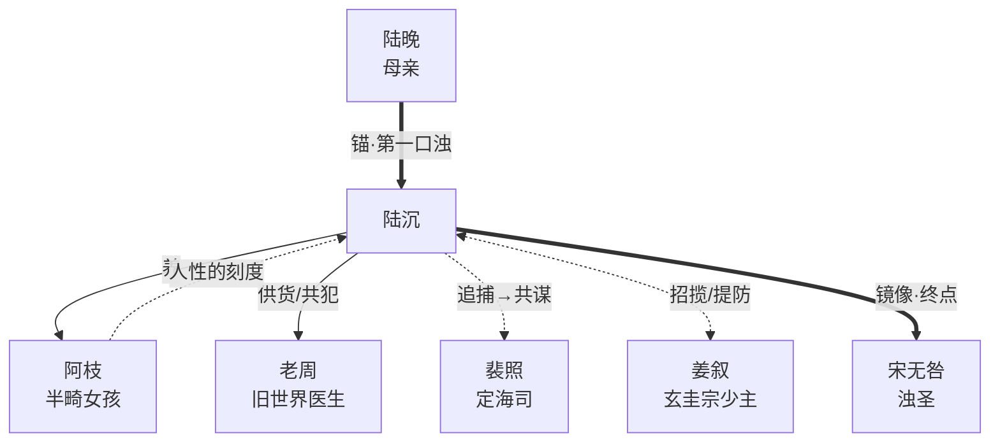

# 《浊世》设定集

> 备选书名：《空窍》《灵浊》《滤》《大汐》
>
> 一句话内核：**修为越高，越不像人；而他做的事，是替这个世界把脏东西咽下去。**

---

## 一、世界观

### 1.1 世界一句话

天裂之后七十三年的地球。灵气回来了，但它是脏的。

这不是"灵气复苏、人人修仙"的爽文世界，也不是"丧尸围城"的废土。这里是**一个被灵气污染的世界**：浓度决定力量，浊度决定你还能不能算人。

### 1.2 时间线

| 时间 | 事件 |
|---|---|
| 旧历 2029.3.14 | **天裂**。天空出现一道横贯东西的裂缝，史称"白昼之裂"。 |
| 裂后 0–77 天 | **潮涌期**。全球灵气浓度在 77 天内升至旧时代的约 3000 倍，约 62% 人口死亡。 |
| 裂后 2–20 年 | **淤积期**。灵潮随地形沉降，旧国家机器解体，第一批宗门崛起。 |
| 裂后 20 年至今 | **定潮期**。浓度趋于稳定，但每 12 年一次"大汐"。 |
| 新历 73 年（现在） | 第 6 次大汐刚结束三个月。世界刚被洗过一遍。 |

### 1.3 灵潮的三个阶段

**潮涌期（77 天）**
死因排序并非战争，而是生理性的：

1. **灵爆**——灵气涌入细胞，渗透压失衡，人体在几分钟内胀裂。占死亡人数四成以上。
2. **畸变**——活下来的人中，约三成发生形态改变。多数在 72 小时内失去神智。
3. **兽潮**——动物园、养殖场、昆虫、海洋生物同时变异。
4. **秩序崩塌**——饥荒、踩踏、核电站失控、战争。人类杀死的人类，比灵气杀死的还多。

**淤积期（18 年）**
灵潮像水一样找低处。平原、盆地、地铁深层、矿井变成了"渊"；山脊、高原、废城高层变成了"台"。人类的聚居点从"沿河而居"变成了"沿高而居"。

**定潮期（至今）**
浓度稳定在一个微妙的平衡点：**刚好够人活，刚好够人死。**

### 1.4 灵气的两条属性（核心物理）

灵气只有两个可测量的量：

- **浓度**：决定能修到多高。
- **浊度**：决定你会变成什么。

浊度来自天裂时被撕碎的上古修真界——散落的**残念**：死者的执念、未竟的功法、失败的飞升、没说完的话。它们混在灵气里，无色无味，但会认人。

于是有了这个世界的第一定律：

> **灵浊守恒：灵气不会消失，只会转移和沉淀。**
>
> 被灵气冲刷下来的浊，一定淤积在浓度最高的地方。

推论：**世界上没有干净的宝地，只有还没轮到你付账的宝地。**

所有"灵渊出宝"的传说，背面都写着"去的人没回来"。

### 1.5 地理：渊、台、隙

| 地貌 | 定义 | 灵气 | 出产 | 危险 |
|---|---|---|---|---|
| **渊** | 灵潮沉降的盆地、裂谷、矿井、地铁深层 | 浓度极高，浊度极高 | 灵石、灵植、畸变兽的角与骨 | 兽潮、浊雾、空间塌陷 |
| **台** | 山脊、高原、废城高层、人工堆土台 | 浓度低，浊度低 | 抗灵作物、旧世界物资、人口 | 灵气贫瘠，修士上限低 |
| **隙** | 天裂残留的空间裂缝 | 不稳定，时高时低 | 上古修真界的碎片——"残界" | 有进无出，时间流速不同 |

**台与渊之间，是整个世界的政治。**

台上有粮食和人，渊里有灵石和力量。谁控制了两者之间的通道，谁就是这个世界的主人。

### 1.6 人类的三种活法

**修士**——主动引灵入体，用功法把灵气锁进经脉。
需要三样东西：**灵根**（天生，决定上限）、**功法**（传承，被宗门垄断）、**锚**（神魂稳固物，见后文）。
他们是这个世界的新贵族，也是最短命的职业。

**畸变体**——被浊污染，身体与神智一同改写。
保留人性的叫"半畸"，是黑市里最便宜也最不要命的劳动力；彻底失去人性的叫"浊兽"，是渊里的主要死因。

**凡人**——不碰灵气。靠旧世界的技术活着：火器、机械、化学、发电机、抗生素。
**旧世界的科技没有失效，只是打不过金丹。** 这句话是凡人的屈辱，也是他们的底牌。

### 1.7 势力版图

| 势力 | 本质 | 掌握 | 主张 |
|---|---|---|---|
| **定海司** | 旧军方与科研机构残余 | 火器工业、灵能武器化、"灵浊测量仪" | "灵气是资源，不是神。" |
| **十二宗** | 灵潮后崛起的宗门联盟 | 功法、灵渊开采权、灵籍制度 | "没有灵根的人，不配进渊。" |
| **鬼市** | 散修、逃犯、半畸者的黑市网络 | 走私、情报、人口 | "活下来就行。" |
| **残界教** | 崇拜天裂的邪教 | 信众、对浊的极端耐受力 | "畸变不是堕落，是飞升的第一步。" |
| **馆** | 一群旧世界科学家 | 灵气物理学、净水与净食技术 | "它一定能被解释。" |

**灵籍制度**是十二宗最狠的一招：登记在册的修士才有权进入灵渊。散修进渊，叫"盗猎"，格杀勿论。
这条制度把"修仙"从一种可能，变成了一种**阶级**。

**经济双轨制**：灵石本位（修士之间）与旧世界物资（凡人之间）并行。一盒没受污染的抗生素，在台上能换一块下品灵石；一块下品灵石，在渊边换不到半瓶干净水。**这个汇率差，是所有人性故事的温床。**

### 1.8 修炼体系（末世变体）

境界名沿用古法，但每一层都加了末世的账单。

| 境界 | 古义 | 末世真相 | 代价 |
|---|---|---|---|
| **引气** | 感应灵气，引入经脉 | 第一次引气，就是第一次让浊进门。**约三成的人在这一步畸变。** | 开脉是一场赌博，赌注是脸 |
| **筑基** | 夯实地基 | 必须有一件**锚**：承载你最强执念的实物。亲人遗物、仇人的骨、一张烧焦的照片。 | 无锚者筑基即"灵崩"，人炸成一片浊雾 |
| **金丹** | 凝结内丹 | 金丹会**记住**你结丹那一刻最强烈的情绪。此后终生被它支配。 | 贪者愈贪，惧者愈惧，爱者愈不能放手 |
| **元婴** | 元神成形 | 元婴会**说话**。它既是你，也是你吞下去的所有残念。 | 大量元婴修士最终被自己的元婴夺舍 |
| **化神** | 神游太虚 | 化神者已不能算人。身体是法则的容器。 | 凡人靠近他们会疯，亲人靠近他们会死 |

**这个世界最重要的一条规则：**

> **心魔不是幻觉，是实体。**
>
> 灵气里全是死人的执念。你突破的时候，它们会借你的嘴说话。很多修士不是败给天劫，是败给一句"你终于来了"。

### 1.9 大汐：这个世界的时钟

每 12 年一次，灵气浓度在 40 天内暴涨 3–5 倍。已发生六次：裂后第 13、25、37、49、61、73 年。

**大汐前 3 年（涨潮期）**：渊开始外溢，浊兽上涌，鬼市物价飞涨，宗门开始抓壮丁。

**大汐 40 天**：凡人必须撤入"净室"（用旧世界过滤技术改造的地下空间）。修士战力翻倍，畸变率也翻倍。**这是修士一年里唯一敢拼命的时候，也是一年里死得最多的时候。**

**大汐之后**：地貌改写。旧的渊可能填平，新的渊可能裂开。**所有地图作废。** 所有土地契约作废。所有仇恨重新计算。

**当前的不安**：第 6 次大汐比预测**提前了 4 个月**，强度超出 40%。十二宗对外宣称"测量误差"，馆里的人私下说："周期在变短。"

如果规律失效，下一次可能不是 11 年后。

**可能是明天。**

### 1.10 四个悬念（长线）

1. **天裂是谁撕的？** 官方说法是上古大能飞升失败。但残界里挖出的一块碑上写着四个字：*"天自己裂的。"*
2. **灵潮为什么有周期？** 涨落得太像呼吸了。谁在呼吸？
3. **残界里的上古修士，是死了，还是在等？** 隙那边偶尔会传出钟声。钟声很准，每 12 年响一次。
4. **大汐为什么一次比一次强？** 有人算过：按这个增速，第 9 次之后，就没有"台"了。

### 1.11 主题

末世修仙的真正问题不是"怎么变强"，是——

> **变强之后，你还是不是人？**

- 一个人能徒手拆楼，法律就成了笑话。但旧世界的东西没有全死：一包没污染的药，一台还能响的收音机，一句迟到了七十年的"对不起"。
- 修士追求长生。在末世里，长生是诅咒——你要看着所有人死，包括你自己认识的那个自己。
- 这个世界最贵的不是灵石，是**干净**：干净的水、干净的粮、干净的手、干净的良心。

---

## 二、主角：陆沉

### 2.1 三句话

**他是个拾荒的。**
**他有一口别人没有的洞。**
**他靠替这个世界咽脏东西活着。**

一句话人设：**一个把救命当买卖做的人，因为他不敢承认自己在救人。**

### 2.2 档案

| 项 | 内容 |
|---|---|
| 姓名 | **陆沉**（随母姓；父亲一栏，户口本上是空的） |
| 年龄 | 24 岁。新历 49 年生，**生在第四次大汐里** |
| 外号 | **漏斗**（鬼市先叫来取笑他，后来叫得没人敢当面笑） |
| 境界 | 引气零层。无灵根，测灵三次，三次皆零 |
| 身份 | 渊边拾荒者 / 鬼市净灵液供货人 / **灵籍：无** |
| 住处 | 台七区外沿，一间用旧净室隔出来的隔间。老周住里屋，阿枝住阁楼 |
| 锚 | 一条旧医院新生儿腕带。塑料已经发黄，上面印着"陆晚"和一个再也查不到的编号 |
| 家伙 | 一根撬棍（捡东西用的，也用来打人）；一把只剩三发子弹的旧手枪 |
| 规矩 | 不收谢；不欠人情；不在别人面前吐黑血 |

### 2.3 他看着像个什么人

二十四岁，看着像三十。不是老，是**收**：肩膀永远半侧着，随时能退半步。

手指关节粗大，指甲缝里有一层洗不掉的黑——那不是泥，是浊留下的痕。所以他一年四季戴着手套，连吃饭都不摘。有人问他，他说"怕冷"。

眼白有一点点灰。鬼市的人以为他是半畸，躲着他走。他从来懒得解释。

走路没声音。这是拾荒练出来的：在渊里，脚步重的人捡不到东西，只捡得到死。

**三个小动作**（写的时候反复用，人物就立住了）：

1. 谈价的时候，用拇指反复擦手套的虎口。
2. 浊池里开始有人说话的时候，咬一下舌尖。他不叫，只是很轻地"嘶"一声。
3. 每天睡前，用指腹把腕带上的字摸一遍。不是看，是摸。他怕自己哪天忘了怎么念。

### 2.4 三层性格

**表层：一个讲规矩的生意人。**
客气，疏离，报得出每一笔价：净一口井多少钱，清一道伤口多少灵石，救一条命要抵押什么。他从不免费，从不赊账，也从不还价。鬼市的人说"漏斗这人不讲情，只讲数"。

**中层：计算型的善良。**
他不是不救。他是先在心里算一遍"这一趟我赔多少"，然后照样救。
他允许自己吃亏，但一定要记在账本上。那本账本他记了五年，记满了三本，从来没有人还过。他也从来没催过。

**底层：一个被留在产房里的孩子。**
他既想被人抓住，又怕被人抓住。
他所有的冷静，都来自同一件事——**他不敢有情绪。**
因为浊池会记住情绪。他恨过谁、怕过谁、爱过谁，那些人的声音就会留在池子里，在他最虚弱的时候，用最像他们的语气，跟他说最像他们会说的话。

> 所以他不是天生冷。他是**不敢热**。

### 2.5 前史（不一次说完，分三卷抖）

**新历 49 年，第四次大汐。**
台七区临时产房。一个女人在阵痛里畸变，把体内的浊往外逼——逼不出去。浊只会往下走。
于是她把浊逼进了自己刚生下的孩子体内。那个还没成形的空窍，是唯一的容器。

她死的时候，助产士只来得及剪下腕带，套在孩子手上。

**11 岁到 14 岁**：被渊边一支拾荒队的哑巴老头捡走。老头教他三件事：怎么在雾里听方向、怎么从尸体上取东西不惊动浊兽、怎么不回头。
老头死于一头六条腿的浊兽。陆沉回头了，所以他活着；老头没回头，所以他死了。

**19 岁**：他第一次"净"。一个走火入魔的散修倒在渊边，浑身是浊。他伸手，贴住对方额头，浊走了，人活了。散修塞给他一块下品灵石，然后惊恐地看了他三秒，跑了。
那天晚上，他第一次听见浊池里有声音。
那天晚上，他也第一次有了钱。

**19 岁到 24 岁**：他靠这门手艺活了下来，也靠这门手艺养活了两个人——老周和阿枝。
他从没跟任何人说过那口洞是怎么来的。鬼市问他师承，他说"祖传"。

### 2.6 他想要什么，他需要什么

| | 内容 |
|---|---|
| **想要的**（他自己说的） | 攒够三十块中品灵石，买一张台三区的外居证，洗手不干，做个普通人。 |
| **需要的**（他自己不承认） | 承认他早就不在做买卖了。他想要的是被人需要——而且要有人在知道他不干净之后，还认他。 |
| **一句话** | 他想要"干净"，他需要"脏了也还有人要他"。 |

**这个错位，就是全书的动力。** 他每往"想要"走一步，就离"需要"远一步。
等他真买下那张外居证的那天，他会发现：台上没有人需要他。而台下，所有人都在等他。

### 2.7 他怎么打架（重要）

**他不修仙。他境界零。他的打法是贴脸。**

修士的攻防建立在灵气外放上：掌风、剑气、护体灵光。而他身上那层膜只做一件事——**拦浊**。

所以他的战斗逻辑是反的：

1. **先挨。** 硬吃对方的浊功。别人护体灵光是盾，他是"没有盾，所以打不坏"。
2. **贴上去。** 三米、一米、手掌按上对方胸口或额头。
3. **抽。** 把对方体内的浊抽进自己池子——一个修士被抽走三成浊，功法就散了，战力掉一半。
4. **或者灌。** 把浊池的浊反手灌进对方经脉，叫"逆灌"。轻则废人，重则炸成一团浊雾。

**三件套**：
- **撬棍**——近身压制，撬开护体灵光的缝隙，也撬开浊兽的甲。
- **手掌**——他唯一的"法术"。
- **浊丹**——一炷香内战力翻倍，之后三天畸变痛。他不爱吃，吃完会梦见产房。

**那把枪**：三发子弹。他从没跟人说过第三发留给谁。阿枝问过，他说"留着打野狗"。

**他的四个死穴**（写打戏时轮着用）：
1. **怕围殴**——他一次只能贴一个人。
2. **怕远程**——贴不上就等于没本事。
3. **怕流弹**——他不防弹。一颗子弹，一枪一个洞。
4. **怕消耗**——净化有速率上限。他能救人，救不了洪流。

> 一个能徒手废掉金丹的人，会被三个拿刀的凡人堵死在巷子里。
> 这是这本书最好用的紧张感来源。

### 2.8 弱点、恐惧、漏洞

- **怕安静。** 浊池在他安静的时候说话最清楚。所以他睡觉从不关窗，宁可用风声盖过去。
- **怕被道谢。** 道谢会让他觉得自己在卖命，而卖命的人最后会要价。他的原话：**"我不收谢。谢是赊账。"**
- **怕自己的名字。** 腕带上的编号已经查不到了。他其实不确定"陆沉"是不是他的名字，还是那个女人临死前随便叫的一个音。
- **怕阿枝长大。** 半畸的孩子活不过二十岁。他知道。他一直在假装不知道。
- **漏洞：五成线。** 他给自己定的规矩是浊池不超过五成。但只要有人在他面前快死了，他会破规矩。
  **这条线是可以被钓的**——敌人不需要打赢他，只需要在他面前挂一个人。

### 2.9 人物关系

| 人物 | 身份 | 与他的关系 | 一句话 |
|---|---|---|---|
| **老周**（周敬之，76） | 台上的旧世界医生，净室管理员 | 半个爹、债主、共犯 | "我给他抗生素，他给我净灵液，我们谁也没欠谁。"——这话老周说过四次，每次都是在骗自己。 |
| **阿枝**（11） | 半畸女孩，左臂覆鳞 | 他养的人，他的人性刻度 | 她不叫他爹，叫他"漏斗"。他纠正过三次，后来不纠正了。 |
| **裴照**（29） | 定海司灵浊研究员，测量仪的记录者 | 追他的人，也是唯一一个开始把他当人看的人 | 档案里他叫"样本七号"。她第一次当面叫他"陆沉"的时候，手在抖。 |
| **姜叙**（25） | 玄圭宗少宗主，天品灵根 | 亦敌亦友，招揽者与威胁者 | "灵籍制度是我家定的。我想知道它到底对不对——所以我得先抓住你。" |
| **宋无咎** | 残界教"浊圣"，人形渊 | **他的终点** | 宋无咎见他的第一句话是："你身上有个洞。我身上也有一个。区别是，你在往外滤，我在往里塌。" |
| **陆晚** | 母亲，死于新历 49 年 | 他的锚，也是他体内第一口浊 | 浊池最深处那个声音，从来不说话，只是很轻地哼一支歌。 |



### 2.10 三个名字

同一个人，三种叫法，代表三种看待他的方式——**这可以作为全书的一个小主题，反复回响**：

- **鬼市叫他"漏斗"**：一件好用的工具。
- **通缉令上写"无名氏·甲"**：一个需要被处理掉的麻烦。
- **定海司档案里是"样本七号"**：一个需要被研究的现象。
- **只有阿枝叫他"漏斗"的时候**，那两个字是名字。

他一生都在等一个人，不带任何目的，叫一次他的本名。

### 2.11 台词样本（找语感用）

> "净化一口井，两块下品灵石。清一道伤口，半块。救人——看你身上有什么。"

> "我不收谢。谢是赊账。"

> "你们修的是仙。我修的是不疯。"

> "我身上这口洞，是我妈留给我的。她没来得及给我别的。"

> "别站我后面。我后面不干净。"

> "仙？仙是活到最后的那个人给自己起的名。"

> （浊池满到七成，他对着空屋子）"……我知道是你。你别急。等我死了，你再说话。"

### 2.12 弧光（三卷）

**卷一「漏斗」**——他从一件工具，变成一个被通缉的人。
他第一次为不认识的人破例，第一次破了五成线，第一次发现救人也是要还的。

**卷二「净」**——生意做大。定海司要他的能力，十二宗要他的手，鬼市要他的命。
他会第一次尝到"干净"是一种权力：有人跪下来求他，有人愿意为他杀人。
**这一卷他离堕落最近**——不是被浊吞掉，是被感激吞掉。

**卷三「空」**——大汐提前，他必须一次性清空浊池。
唯一的办法是把整口池子倒进天裂。
在裂缝里，他见到了母亲的残念。她要他留下——那里没有疼，没有声音，没有账。
他走了。因为他想起来了：他这辈子没欠过谁，只欠她一条命。而他打算用活着来还。

> 结局不写成仙。他没成仙。
> 他把那口洞留在了自己身上，然后去做那个"让洞里透光的人"。

---

## 三、金手指：「空窍」

### 3.1 一句话

**他不是灵气的容器，他是灵气的滤网。**

### 3.2 设定

主角天生"无灵根"。
准确地说，他的灵根是**漏的**：灵气进来就流走，一丝存不住。测灵三次，三次都是零。所有人都判定他是废人，包括他自己。

真相是：他体内有一条从百会贯到涌泉的**空窍**——中间空无一物，只有一层看不见的"膜"。

灵气流过时，那层膜会做一件事：

> **拦住"浊"，放行"清"。**

于是出现了这个世界从未有过的现象：

**灵气在他体内不存留，但被净化了。**

他是唯一一个"不储存灵气，却能改变灵气"的人。

### 3.3 三种用法

| 用法 | 名称 | 具体操作 | 收益 |
|---|---|---|---|
| 一 | **净** | 手掌贴住污染源：浊水、畸变的伤口、带浊的灵材、走火入魔的修士 | 末世最硬的通货是"干净"。他能把脏东西变干净。 |
| 二 | **萃** | 让稀薄灵气反复穿过空窍，越滤越纯，凝成"净灵液" | 一升净灵液的市价 ≈ 一门下品功法 |
| 三 | **噬** | 主动吞纳浊气，压进体内沉淀池 | 短时间爆发力。浊是燃料：暴烈、伤身、但不要钱 |

净、萃、噬——一个救人，一个赚钱，一个保命。

### 3.4 代价：浊池

被滤下来的浊不会消失。

它会沉在丹田下方，形成一口**浊池**。

浊池有刻度：一成、三成、五成、七成……

**满了会怎样？**

> **浊会认主。**
>
> 它会开始用他吸过的所有人的声音说话。
>
> 然后它会想出来。

清池只有一个办法：**把浊"倒"给一个承受得住的存在**——更强的浊兽、残界里的东西、或者一个自愿的人。

于是主角的核心循环是：

```
净化别人 → 自己变脏 → 必须去找更脏的东西 → 变强 → 能净化更大的东西 → 更脏……
```

**他越救人，越接近怪物。**

这就是这本书的引擎。

### 3.5 浊不是废物

沉淀下来的浊，是原料，不是垃圾。

| 产品 | 做法 | 效果 | 副作用 |
|---|---|---|---|
| **浊丹** | 浊池沉淀物压制成丸 | 服下后一炷香内战力翻倍 | 三天畸变痛，皮肉会短暂长出不属于人的东西 |
| **浊器** | 把浊灌进凡铁 | 武器"记住"死者的执念，锋利得不讲道理 | 它会用持有者的记忆喂养自己 |
| **浊影** | 浊池过半后凝出的人形 | 复制他部分记忆与战力，替他挡刀 | 它会想取代他 |

所以金手指自带一套**资源管理**的乐趣：清池要付代价，但浊本身是资产。**攒着危险，用掉浪费。**

### 3.6 三阶解锁

| 阶 | 名 | 能力 | 解锁条件 | 代价 |
|---|---|---|---|---|
| 一阶 | **滤** | 净、萃、噬，浊池开始积累 | 裂后第一次接触高浊灵气 | 从此没有回头路 |
| 二阶 | **逆** | 反向灌灵：把净灵液强行注入他人、灵材、阵法——造"伪灵根"，或者炸炉 | 浊池首次接近满，主角濒死 | 每逆灌一次，身上永久多一道"裂纹"，折寿一年 |
| 三阶 | **空** | 空窍贯通全身，成为纯粹的通道——能把一整片区域的浊抽走，短暂制造"净土" | 与一个上古残念达成交易 | 净土只存在于他在的地方。他走了，浊会回来得更凶 |

三阶叫"空"。
因为他从来不是容器，他是**通道**。

而这个世界已经有一个最大的通道了——天上那道裂缝。

**他可以是下一个洞。也可以是下一个裂缝。**

### 3.7 为什么是他

空窍不是天赋，是**事故**。

新历 49 年，第 4 次大汐。
一个女人在产房里畸变，用最后一点神智，把体内的浊往外逼。

她逼不出去。浊只会往下走。

于是她把浊逼进了自己刚生下的孩子体内——那个还没成形的空窍，成了唯一的容器。

**他身上那个洞，是他母亲留下的。**

这就是他的"锚"。也是他每次浊池快满时，唯一能让他想起"我是谁"的东西。

### 3.8 限制（防止无敌）

**① 净化有速率上限。**
靠手掌接触面积和时间。一秒能净化的量是有数的，救不了洪流。他不是神，他是一只手。

**② 浊池满了会"泄漏"。**
周围三米的植物枯萎，水变臭，人做噩梦。这会暴露他。**他不是不能被找到，是不能被养大。**

**③ 最要命的一条：**

> **他能滤掉"浊"，但滤不掉"清"。**

灵气分两种打法：
- **浊功**——绝大多数修士的路子。猛、快、脏。对他几乎无效，因为浊被膜拦住了。
- **纯灵**——真正高手的路子。干净、纯粹、昂贵。**直接穿透他，一点不剩。**

所以他有一个反常识的天敌名单：

| 威胁 | 对他有效吗 |
|---|---|
| 金丹修士的浊煞掌 | ❌ 无效 |
| 浊兽的毒牙 | ❌ 无效 |
| 化神修士的一道纯粹剑气 | ✅ 一剑两段 |
| 一颗子弹 | ✅ 一枪一个洞 |
| 三天没吃饭 | ✅ 会死 |

**修士杀不了他，凡人能杀他。**

一个不修仙的人，拿一把旧世界的枪，可以杀死这个世界上最特殊的人。

这个设定同时解决了两件事：金手指不会让他无敌；而"凡人的价值"在这个修仙世界里，有了实打实的位置。

### 3.9 镜像：他的终点

有一个和他完全相反的人。

一个被浊彻底吞掉的人——体内没有膜，只有一口永远填不满的井。他走到哪里，哪里就烂。他被称为"人形渊"，是残界教供奉的"活圣人"。

**如果主角失败，就会变成他。**

主角每一次清池，都是在推迟那一天的到来。

> 他的本名：**宋无咎**。他不自称"浊圣"，他自称"我"。因为他已经不记得自己叫什么——这是他唯一还没被吞掉的东西。

---

## 四、开篇钩子（可直接用）

> 渊边。雾很稠，稠到能听见里面有人说话。
>
> 他在捡东西——死人的灵石、断掉的剑、还算完整的骨头。
>
> 一头浊兽从雾里出来，前腿是人的手臂，一共六条。
>
> 他没跑。他伸手，贴住那东西的额头。
>
> 三秒后，兽倒了。他吐了一口黑血，抹了抹嘴，把兽嘴里的灵石抠出来。
>
> 远处山脊上，定海司的灵浊测量仪，指针第一次偏到了红色区域。
>
> 那天晚上，鬼市挂出一张悬赏：
>
> **"活捉。要手。"**

**第一幕要交代的三件事**：他能净化、他有代价、他被看见了。

---

## 五、写作备忘

**节奏骨架**：以大汐为倒计时。每卷结尾推近一次"潮"。第 6 次大汐提前了 4 个月这条线，要一直吊着。

**必须避免的三个坑**：
1. 不要写成"我净化万物、众人跪拜"。他的能力越有用，越应该被**争夺**，而不是被感谢。
2. 不要让他靠净化直接升级。净化不涨修为，只涨**筹码**。修为还得自己练。
3. 不要让浊池变成单纯的"血条"。它是**另一个角色**——会说话、会骗人、会在他最虚弱的时候提出一个很合理的建议。

**陆沉的四条写作纪律**：
1. 他永远是先算账再救人。**别让他变成圣人**，圣人没有戏。
2. 他的强，强在"别人打不疼他"；他的弱，弱在"他打够了就走不了"。打戏永远往这两个方向写。
3. 他每一次破"五成线"，都要付出一个**具体的**代价（一个伤、一个人、一次暴露），不能只是"很难受"。
4. 他从不说"我要救你"。他只说"这活儿多少钱"。

**名词表**：天裂 / 潮涌 / 淤积 / 定潮 / 大汐 / 涨潮期 / 渊 / 台 / 隙 / 残界 / 残念 / 灵浊守恒 / 灵爆 / 畸变 / 半畸 / 浊兽 / 灵籍 / 净室 / 净灵液 / 浊池 / 浊丹 / 浊器 / 浊影 / 锚 / 灵崩 / 空窍 / 滤·逆·空 / 漏斗 / 逆灌 / 五成线

**人物表**：陆沉（主角·漏斗）/ 陆晚（母亲）/ 老周·周敬之（医生）/ 阿枝（半畸女孩）/ 裴照（定海司研究员）/ 姜叙（玄圭宗少宗主）/ 宋无咎（浊圣·人形渊）
